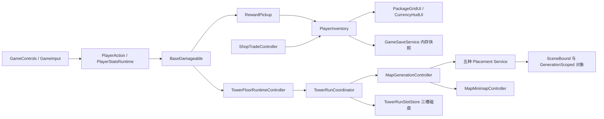
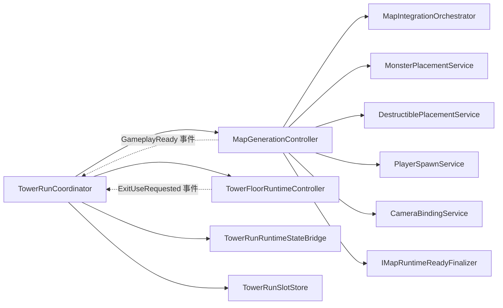
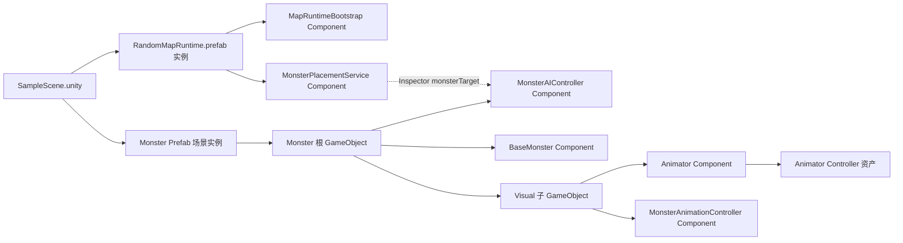
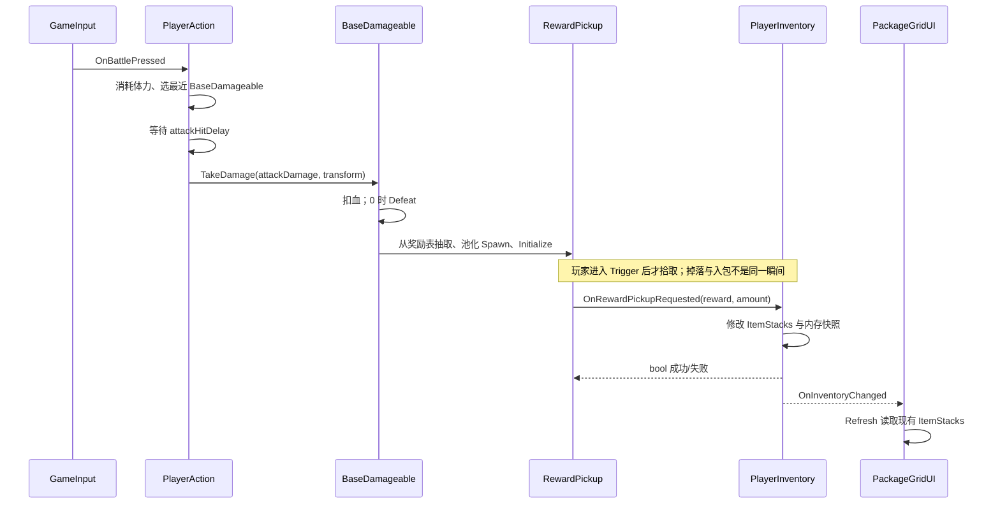
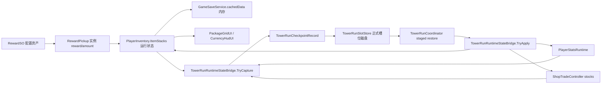
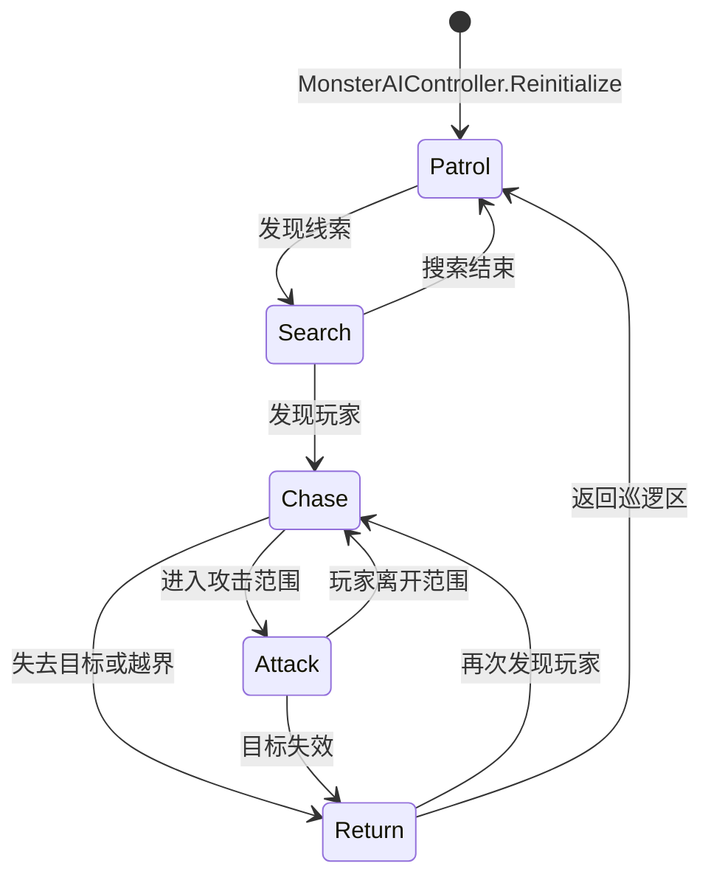
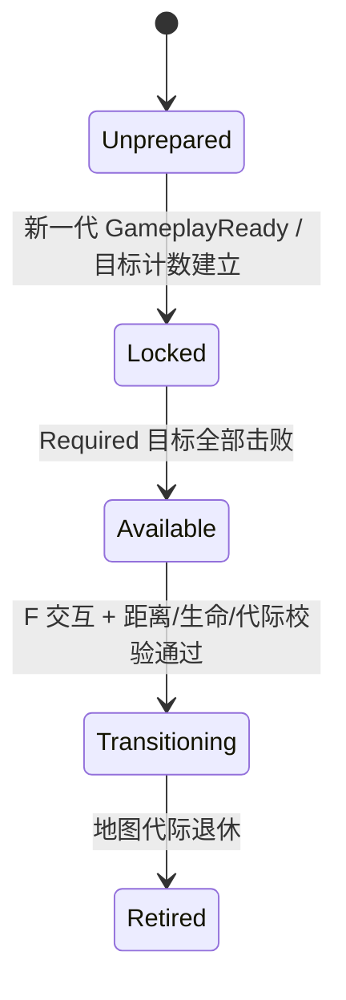

> 本轮整合上下文（2026-10-25）：本文原有叙述与验收数字保留为各节标明日期的历史快照。游戏主线已在候选提交 `96371eb36a787585cf5e70141c03555419821058` 保存，其父链包含九个 TowerRun/Portal/UI 提交；默认新冒险 Profile 为 `MainV1`，十二种保留原生怪物，Boss 仍待内容。旧 `ecology-v1`、UI v6 未提交、旧工作树/HEAD 等现在式叙述均不代表本轮状态。新整合 Build/Player 与人工验收只认本轮独立收据；Stage1、B1、Boss 和旧 R4 人工结论不升级。当前整合总账见 `../Integration/MainConsolidation20261025/README.md`。

# 分层架构图（Mermaid 源码）

本页是第一版系统级图。Phase 2 的三条逐方法业务链图见 [PHASE2-CHAIN-STUDY.md](PHASE2-CHAIN-STUDY.md)，其运行证据见 [VALIDATION.md](VALIDATION.md)。以下历史图中的“运行待验”标记应按最新验证页复核。

每图只回答一个问题。实线是源码/序列化资产已核查的连接；虚线文字标注“运行待验”的地方需要 Unity 运行证明。图中不将文件名相近误当成调用。节点精确文件、行号和完整 GUID 边见 `graph.json` 与 `viewer.html`。

## A. 总体：玩家操作如何抵达游戏状态与画面？

证据：`GameInput.cs:204-210`、`PlayerAction.cs:177,307`、`BaseDamageable.cs:102-104,146-157`、`PlayerInventory.cs:146,202-217`、`PackageGridUI.cs:61`、`TowerRunCoordinator.cs:200,336,380-423`、`MapGenerationController.cs:123,160-214`。

## B. 依赖：关键方向及高耦合点

`TRC ↔ Floor` 和 `TRC ↔ MGC` 是**调用加事件回传**，不等于源代码级循环 import。`MapGenerationController.GenerateMap` 协调多个服务与生命周期阶段，属于修改影响面较大的中心节点（`MapGenerationController.cs:35-345`）。`TowerRunCoordinator.BindScene` 通过查找场景对象取得依赖，隐式装配需要运行时检查（`TowerRunCoordinator.cs:97-119`）。

## C. Unity 对象/资产：场景到 Monster Visual

`SampleScene.unity` 对 `RandomMapRuntime.prefab`、Monster Prefab 有序列化 GUID；Prefab 中根对象和 `Visual` 的组件可由查看器搜索当前具体资产。`MonsterPlacementService` 的 `monsterTarget` 是否在 Inspector 指向预期实例，需结合场景 fileID 与 Unity Editor 复核；不能从类名推断。图中当前 Monster 资产在审计期间改名，本图故使用语义名，准确路径看最新 `graph.json`。持久化 Shop Toggle→`ShopGridUI` 的四条 UnityEvent 关系在图谱中可搜索 `UnityEvent calls`。

## D1. 运行时流程：玩家攻击到拾取

注意：命中是攻击开始时选定目标，延迟后做存活检查；`BaseDamageable` 包括 Monster、Animal、Plant 等受击对象，并非只找怪物（`PlayerAction.cs:235-242,284-334`）。掉落随机表可能不产生任何物品（`BaseDamageable.cs:135-148`）。

## D2. 运行时流程：地图请求到可玩

```mermaid
flowchart LR
  Request[TowerRunCoordinator 创建 MapGenerationRequest] --> Execute[MapIntegrationOrchestrator.Execute]
  Execute --> Pending[RandomMapGenerator 生成 MapData]
  Pending --> Plan[静态与语义 placement 规划]
  Plan --> Commit[CommitPending / 退休旧 Registry]
  Commit --> Render[Tilemap 与装饰投影]
  Render --> Materialize[搬移 SceneBound / 生成 Destructible]
  Materialize --> Spawn[玩家定位]
  Spawn --> Reinit[地图依赖重初始化]
  Reinit --> Bind[Camera 绑定]
  Bind --> Finalize[Floor/Restore finalizer]
  Finalize --> Ready[GameplayReady]
```

`MapData` 在 Commit 前是 pending；Commit/Project 后仍需 Materializing、Reinitializing、BindingCamera、ValidatingRuntime 与 Finalizer 才 Ready（`MapIntegrationOrchestrator.cs:55-93`、`MapGenerationController.cs:142-346`）。绝不能把“MapData 存在”直接说成“角色可操作”。

## E. 数据流：背包与三槽检查点

数据拥有者与持久层有意分开：`GameSaveService.TrySave` 只替换进程内缓存（`GameSaveService.cs:198-221`）；`TowerRunSlotStore.TryCommit` 才是正式槽位写入（`TowerRunCoordinator.cs:184-204`）。保存的是楼层入口候选，不能把任意中途血量/背包变化说成已经自动写入三槽。

## F. 状态与生命周期：Monster FSM 和楼层出口

这是源码中真实的 `MonsterStateType` 状态机：`MonsterAIController.cs:67-71,124-139`、`MonsterPatrolState.cs:37`、`MonsterSearchState.cs:41,57`、`MonsterChaseState.cs:43-79`、`MonsterAttackState.cs:50-82`、`MonsterReturnState.cs:36-46`。具体感知、碰撞、动画时序仍需 Play Mode。

出口图为 `TowerFloorRuntimeController` 的源码行为摘要，不代替自动化/人工验收。关键判断在 `TowerFloorRuntimeController.cs:116,163-213,271-289`。
