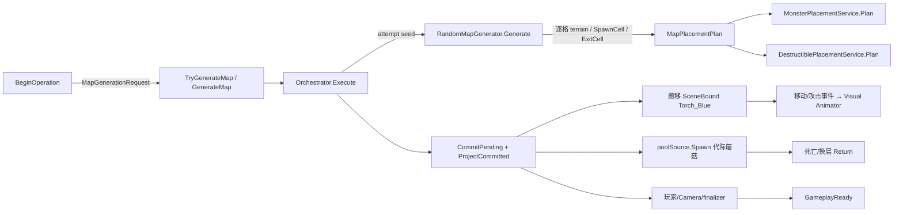
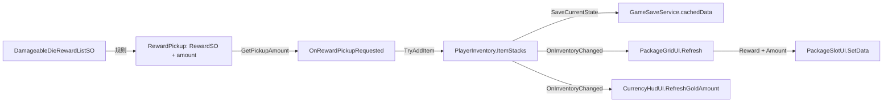

> 本轮整合上下文（2026-10-25）：本文原有叙述与验收数字保留为各节标明日期的历史快照。游戏主线已在候选提交 `96371eb36a787585cf5e70141c03555419821058` 保存，其父链包含九个 TowerRun/Portal/UI 提交；默认新冒险 Profile 为 `MainV1`，十二种保留原生怪物，Boss 仍待内容。旧 `ecology-v1`、UI v6 未提交、旧工作树/HEAD 等现在式叙述均不代表本轮状态。新整合 Build/Player 与人工验收只认本轮独立收据；Stage1、B1、Boss 和旧 R4 人工结论不升级。当前整合总账见 `../Integration/MainConsolidation20261025/README.md`。

# Phase 2：三条真实链路的读码与验证

本页是**当前工作树的源码核证教学稿**，不是学习者掌握度证明。图中的实线表示指定源码行/序列化字段可核查；只有 [VALIDATION.md](VALIDATION.md) 中带测试 XML 和退出码的记录才可称本次运行验证。打开 [离线查看器](viewer.html)，先选“业务链”，再点关系查看方法、数据和证据行。`textual only` 边只是 C# 字符匹配，不参与下面的方法调用结论。

## A. 新局到地图对象与可玩状态

### 1. 游戏现象与 Unity 对象

玩家开始新局或换层，地形、玩家、怪物和可摧毁物重新布置，最终才允许操作。`SampleScene` 中的 `RandomMapRuntime` Prefab 实例挂 `MapRuntimeBootstrap`、`MapGenerationController`、`MonsterPlacementService`、`DestructiblePlacementService` 等组件；独立场景实例 `Torch_Blue` 的父物体挂 `MonsterAIController`、移动、攻击和 `BaseMonster`，子物体 `Visual` 挂 `SpriteRenderer`、`Animator`、`MonsterAnimationController`。`RandomMapRuntime.prefab:1200` 的 `monsterTarget` 是空值，**场景 override** 在 `SampleScene.unity:49500-49502` 指向场景 Monster AI 组件；隔离 Unity Editor 的合成引用审计与 Play Mode 测试已确认它解析为当前 `Torch_Blue`。`Torch_Blue.prefab:267,350,370-379` 是 Visual 与 Controller/脚本/参数名的 YAML 证据。

### 2. 真实调用和数据修改

| 顺序 | 方法与源码 | 输入、修改、输出 |
|---|---|
| 1 | `TowerRunCoordinator.BeginOperation → MapGenerationController.TryGenerateMap`，`TowerRunCoordinator.cs:303-348` | 构造 `MapGenerationRequest`，携带请求 ID、seed 和重试策略。 |
| 2 | `MapGenerationController.GenerateMap → MapIntegrationOrchestrator.Execute`，`MapGenerationController.cs:122-132` | 三个回调分别负责 `GeneratePending`、`BuildPlacementPlan`、`ProjectCommitted`。 |
| 3 | `GeneratePending → RandomMapGenerator.Generate`，`MapGenerationController.cs:436-450`、`RandomMapGenerator.cs:15-56` | 克隆 `MapGenerationSettings` 后写入 attempt seed；创建 `MapData`、`SpawnCell`、`ExitCell`。`FillWithNoise` 逐格采样高度、湿度、温度并 `SetTerrain`，不是先为整图选一个 biome（`RandomMapGenerator.cs:147-197,218-242`）。 |
| 4 | `BuildPlacementPlan → MonsterPlacementService.Plan / DestructiblePlacementService.Plan`，`MapGenerationController.cs:453-472` | 两者读取同一 `MapData` 与代际 ID，按各自允许地形、路径距离等约束写 `MapPlacementPlan`。Monster 必需且一个，Destructible 目标数八、至少四个；具体配置可被 Inspector 覆盖（`MonsterPlacementPolicy.cs:11-93`、`DestructiblePlacementPolicy.cs:12-100`）。 |
| 5 | `MapIntegrationOrchestrator.Execute`，`MapIntegrationOrchestrator.cs:55-93` | 验证计划、`CommitPending`、退休旧 `MapObjectRegistry`、投影 Tilemap，阶段进入 `Materializing`。此时**尚未** `GameplayReady`。 |
| 6 | `MapGenerationController.GenerateMap`，`MapGenerationController.cs:159-209` | 依次物化 Merchant、Monster、Destructible、Animal、Plant。Monster `TryMaterialize` 把既有场景对象移到 reservation cell 并 `TryBindInstance`（`MonsterPlacementService.cs:91-185`）；Destructible 的 `poolSource.Spawn` 取得实例、订阅死亡并注册代际清理（`DestructiblePlacementService.cs:233-315`）。 |
| 7 | `PlayerSpawnService.TrySpawn`、重初始化、`CameraBindingService.TryBind`、finalizer、`PublishGameplayReady`，`MapGenerationController.cs:211-346` | 玩家坐标、摄像机目标、楼层/恢复收尾按阶段完成；失败记录 `MapRuntimeContext.Failure`，不能只看见地形就判成功。 |

Monster 行为继续经 `MonsterAIController.Update/ReinitializeForMap` 的 Patrol/Search/Chase/Attack/Return 状态（`MonsterAIController.cs:60-117`）。`MonsterMovementController.SetMoving` 发 `OnMovementChanged`，`MonsterAttackController.BeginAttack` 发 `OnAttackStarted`；`Visual` 的 `MonsterAnimationController.OnEnable` 订阅，分别写 `Animator.IsMoving`、`AttackDirection` 和 `Attack`（`MonsterAnimationController.cs:46-60,83-154`）。这些是源码事件连接；最终动作画面、碰撞和追击仍需当前资产 Play Mode/人工观察。

### 3. 设计、独立实现、排错与追问

- **为什么这样设计**：`MapData` 先作为纯逻辑结果，`MapPlacementPlan` 在改场景前统一解决占位冲突；`GenerationId` 与 Registry 把旧代对象和新代对象区分开。Monster 是 `SceneBound（场景绑定）`，保留唯一既有实例；Destructible 是 `GenerationScoped（代际限定）`，换层清退。`GameplayReady` 比 `MapGenerated` 更晚，因它包含玩家、相机和 finalizer。
- **独立实现顺序**：先定义 cell/terrain 与 seed 可重复的 `MapData` → 地形分类和可行走约束 → reservation/冲突校验 → 为每类对象定义所有权与物化接口 → Registry 清理 → 玩家/相机绑定 → 最后发布 Ready；每一步先做小型可重复测试。
- **Unity 调试**：在 `SampleScene` Inspector 查看 `monsterTarget` 的实际对象，再记 `GenerationId`、attempt seed、`MapData.SpawnCell`、Monster reservation、场景 Monster `GetInstanceID()` 与坐标，生成后核对同一 ID、不同位置；查看八个以内蘑菇实例的 `GenerationScopedDestructibleLifetime`，换层后检查旧实例是否回池。Animator 面板观察 `IsMoving/Attack/AttackDirection`；边缘追击、草/沙地排序和水域必须实机观察。
- **面试追问**：为何相同 seed 仍可能失败？回答需要区分地图数据可复现、规划约束、Prefab/Scene 引用、物化后的生命周期失败。为何 Monster 不 `Instantiate`？回答需指出 `SceneBound` reservation 与既有实例重定位的代码。



## B. 玩家攻击、死亡与奖励

### 1. 游戏现象与 Unity 对象

玩家按攻击键，若体力够且选到范围内目标，动作前摇后目标扣血；归零时可能掉落 `RewardPickup`，玩家接触才尝试入包。`GameInput` 是场景输入组件，`PlayerAction` 与 `PlayerInventory` 在 Player 对象上；Monster、Animal、Plant、Destructible 的受击组件共享 `BaseDamageable`。掉落由 `DamageableDieRewardListSO` 规则和 `RewardSO` 资产决定，地面物体可从 `rewardPrefab` 池化取得。

### 2. 真实调用和数据修改

| 顺序 | 方法与源码 | 数据与分支 |
|---|---|---|
| 1 | `GameInput.Battle_performed → OnBattlePressed → PlayerAction.HandleBattlePressed`，`GameInput.cs:204-210`、`PlayerAction.cs:165-177,214-243` | 输入 Gate 不允许时不发事件；体力不足时攻击返回。 |
| 2 | `PlayerAction.HandleBattlePressed`，`PlayerAction.cs:227-243,311-334` | `TryConsumeStamina(attackStaminaCost)` 改体力；`GameSession.SaveRuntimeState` 更新进程内快照；全场搜索 `BaseDamageable` 后取范围内最近目标。 |
| 3 | 延迟命中 → `DealDamageToTarget → BaseDamageable.TakeDamage`，`PlayerAction.cs:284-307`、`BaseDamageable.cs:66-91` | 延迟前选中目标，延迟后复核目标是否仍有效；传入 `attackDamage` 和玩家 `Transform`，`ApplyDamage` 改 `currentHealth`。 |
| 4 | `BaseDamageable.Defeat/SpawnRewards`，`BaseDamageable.cs:95-104,121-158` | 只结算一次，禁 Collider；按 `damageableId` 查奖励表，每条规则独立随机，`ObjectPoolManager.Spawn` 取得地面对象并 `RewardPickup.Initialize(reward, amount)`；也可能不掉任何物品。 |
| 5 | `RewardPickup.OnTriggerEnter2D/TryAcceptReward`，`RewardPickup.cs:49-104` | 玩家 Collider 触发；`RewardSO.GetPickupAmount` 把 roll amount 变成 `finalAmount`；顺序调用全部 `OnRewardPickupRequested` 接收者。任何一个拒绝就保留地面物体。 |
| 6 | `PlayerInventory.HandleRewardPickupRequested → TryAddItem`，`PlayerInventory.cs:181-217,378-403,760-769` | 修改 `ItemStacks`，`SaveCurrentState` 更新 `GameSaveService.cachedData`；失败只回滚**自身**快照；成功发 `OnInventoryChanged`。正式 Tower Run 槽位磁盘提交不在本次拾取内。 |

`BaseDamageable.OnDamaged/OnDefeated` 还被 Monster AI 和 `TowerFloorRuntimeController` 监听（`MonsterAIController.cs:183-196`、`TowerFloorRuntimeController.cs:116`）。因此“死亡 → 奖励”和“死亡 → 出口目标计数”是分开的下游。AA-02 的必要条件是**至少两个启用的接收者**、第一位成功、后位拒绝；代码缺少跨接收者回滚。当前正式场景是否自然形成此条件与最小测试实际结果，以 [ISSUES.md](ISSUES.md) 和 [VALIDATION.md](VALIDATION.md) 为准。

### 3. 设计、独立实现、排错与追问

- **为什么这样设计**：输入事件让输入设备与攻击结算解耦；统一 `BaseDamageable` 让多个目标类型共享伤害/掉落入口；地面奖励与入包分离，背包拒绝时可保留拾取物。多订阅者的事务边界目前不完整。
- **独立实现顺序**：先做目标生命与一次性死亡 → 明确伤害来源与命中时点 → 再加攻击输入/体力/动画 → 掉落表和对象池 → 拾取的单一接收者或原子协调器 → 最后接 UI/持久层。不要从 UI 开始反推数据。
- **Unity 调试**：记录一次攻击的体力前后、目标 `GetInstanceID()`、`currentHealth`、`IsDefeated`、生成奖励数量和 `RewardSO`/`amount`；触发拾取前后记录 `ItemStacks`、地面对象 Active、事件接收者顺序。攻击没伤害时先查 Gate/体力、再查目标选择和延迟后条件。
- **面试追问**：目标在前摇中失效会怎样？为何一次死亡可能没有掉落？两个背包接收者一成一败时为何不能直接称“全部失败”？回答需分别指出 `PlayerAction` 保护条件、随机规则与已写入的第一位状态。

```mermaid
sequenceDiagram
  participant I as GameInput
  participant P as PlayerAction
  participant D as BaseDamageable
  participant R as RewardPickup
  participant V as PlayerInventory
  I->>P: OnBattlePressed
  P->>P: 消耗体力 + 选最近目标 + 等待命中时点
  P->>D: TakeDamage(attackDamage, player Transform)
  D->>D: currentHealth -= damage; Defeat once
  D->>R: Spawn + Initialize(RewardSO, rolled amount)
  R->>V: OnRewardPickupRequested(reward, finalAmount)
  V->>V: ItemStacks + cachedData; OnInventoryChanged
  V-->>R: bool 接收结果
  Note over R,V: 多接收者时前者提交不会因后者拒绝而自动回滚
```

## C. 物品进入背包到玩家看见 UI

### 1. 游戏现象与 Unity 对象

以地面掉落为例，玩家拾取 Branch 后，背包格的图标和数量更新；Gold 还会更新 HUD。`RewardSO` 资产定义图标、拾取数量规则等，运行时 `InventoryItemStack` 保存 `RewardSO` 引用与当前 `Amount`，`PlayerInventory` 持有 `itemStacks`；`PackageGridUI` 和 `CurrencyHudUI` 是观察者。商店、恢复等也可修改背包，但此处选择拾取这条完整可追踪入口。

### 2. 真实调用和数据修改

| 顺序 | 方法与源码 | 观察值 |
|---|---|---|
| 1 | `BaseDamageable.SpawnRewards → RewardPickup.Initialize`，`BaseDamageable.cs:121-158` | 掉落规则提供 `RewardSO` 和本次 roll 的整数 `amount`；只是地面对象，背包未变化。 |
| 2 | `RewardPickup.OnTriggerEnter2D`，`RewardPickup.cs:49-67` | 仅 Player Tag/根对象满足时计算 `finalAmount = reward.GetPickupAmount(amount)`；接收失败时复位 `hasBeenPickedUp`。 |
| 3 | `PlayerInventory.TryAddItemWithoutPersistence`，`PlayerInventory.cs:378-403` | 无既有 stack 就建 `InventoryItemStack(reward, safeAmount)`；已有 stack 则计算新量，超过 `GameSaveService.MaxQuantity` 返回 false。示例：某 stack 原为 16、本次 8，接受后为 24；这是教学数值，不代表本次运行观察。 |
| 4 | `PlayerInventory.SaveCurrentState/TryAddItem`，`PlayerInventory.cs:202-219,760-769` | 库存写入 `GameSaveData` 的进程内缓存；失败时恢复本背包快照。成功发布 `OnInventoryChanged`。`GameSaveService.cs:198-221` 没有正式槽位文件 I/O。 |
| 5 | `PackageGridUI.OnEnable/Refresh → PackageSlotUI.SetData`，`PackageGridUI.cs:53-104`、`PackageSlotUI.cs:114-120,203-218` | UI 启用时订阅并立即刷新，`Refresh` 清旧格、读当前 `ItemStacks`、逐格 `Instantiate`，传 `Reward` 和 `Amount`；Slot 将 `itemIcon` 设为资产图标并把数量文字设为 `x` 加当前数。`CurrencyHudUI.cs:36-77` 类似读 Gold。 |

### 3. 设计、独立实现、排错与追问

- **为什么这样设计**：`PlayerInventory` 是数量的唯一读源，UI 收到通知后读取现值；关闭面板期间漏掉事件，`OnEnable` 仍会刷新。全量重建格子的成本和选中态丢失是 [AA-03](ISSUES.md) 的设计关切，性能影响未量化。
- **独立实现顺序**：先定义 `RewardSO` 的稳定身份与显示数据 → stack 合并/上限和拒绝语义 → 背包变更事件 → UI 启用时初始读取和退订 → 格子显示 → 最后接拾取/商店/保存入口，并验证失败不改 UI。
- **Unity 调试**：在拾取前记录 `RewardSO` 名称、`amount/finalAmount` 和 stack 数；拾取后先看 stack 是否真的变，再看 `OnInventoryChanged` 是否发出、`PackageGridUI` 是否 active 和已订阅、`Refresh` 是否拿到 `slotPrefab/contentRoot`，最后看 `PackageSlotUI.currentAmount` 与 TMP 文本。若 UI 不变，先定位哪一层值没变。
- **面试追问**：为什么 UI 关闭时背包变化仍能在重开后正确显示？`TrySave` 为什么不代表正式存档？为何两个 `PlayerInventory` 会破坏“单一数据源”假设？



**学习顺序**：先 C，拿一个 `RewardSO` 和一个整数从地面走到格子；再 B，把掉落之前的输入、伤害和死亡接上；最后 A，把怪物和蘑菇放进地图代际生命周期。每段先预测具体字段变化，再在 Unity 中观察，并用一次失败分支解释边界。

**运行证据边界**：本次隔离 Unity 测试验证了奖励生成、拾取请求到背包的数量变化，以及地图对象生成和部分 Animator 状态；没有对 `PackageGridUI`、`PackageSlotUI` 或 `CurrencyHudUI` 的最终屏幕显示做自动化或人工验收。C 链最后的 UI 显示目前是源码核证、运行时待验证。
