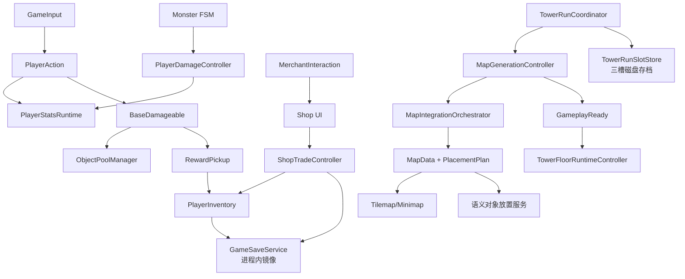
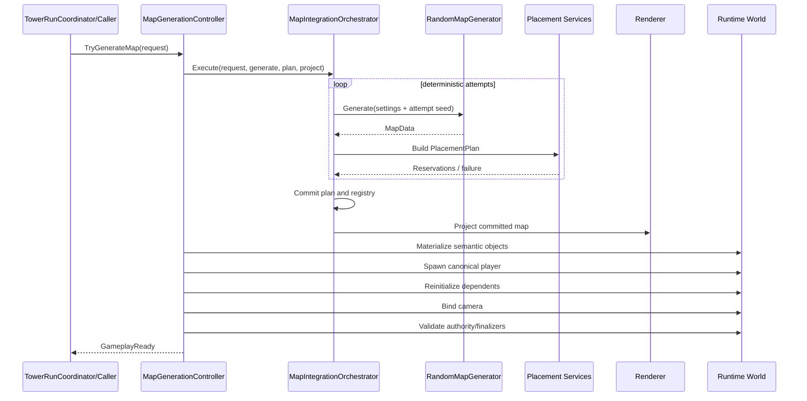
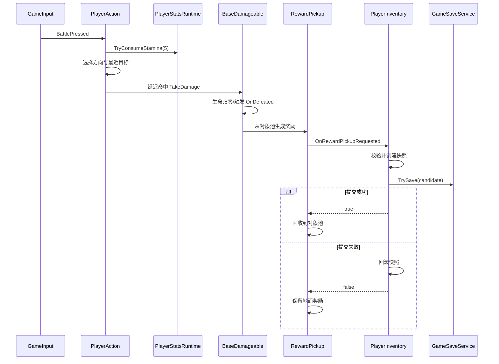
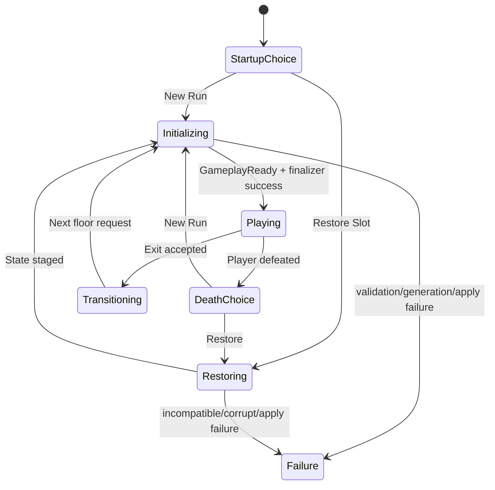

> 本轮整合上下文（2026-10-25）：本文原有叙述与验收数字保留为各节标明日期的历史快照。游戏主线已在候选提交 `96371eb36a787585cf5e70141c03555419821058` 保存，其父链包含九个 TowerRun/Portal/UI 提交；默认新冒险 Profile 为 `MainV1`，十二种保留原生怪物，Boss 仍待内容。旧 `ecology-v1`、UI v6 未提交、旧工作树/HEAD 等现在式叙述均不代表本轮状态。新整合 Build/Player 与人工验收只认本轮独立收据；Stage1、B1、Boss 和旧 R4 人工结论不升级。当前整合总账见 `../Integration/MainConsolidation20261025/README.md`。

# RPG_Demo 系统架构与核心数据流

## 1. 运行时总图



## 2. 场景和 Prefab 组成

### `SampleScene`

`【已验证事实】` 当前场景根对象包括：

- `Main Camera`
- `GameInput`
- 玩家 Prefab 实例 `Warrior_Blue`
- 遗留静态 `Grid`
- `VCam_Player` 与 `Confiner`
- 触发器和方向辅助对象
- `Damageable`
- `EventSystem`
- `Canvas`
- `Characters`
- `Monsters`
- `RandomMapRuntime` Prefab 实例

### `RandomMapRuntime.prefab`

主要组件：

- 生成与显示：`MapGenerationController`、`MapTilemapRenderer`、`MapMinimapController`、`MapSimpleDecorationRenderer`
- 生命周期：`MapRuntimeBootstrap`、`MapGeneratedObjectPlacementAdapter`
- 玩家：`CanonicalPlayerProvider`、`PlayerSpawnService`
- 重初始化：`MapDependentReinitializationService`
- 相机：`PlayerFollowCameraProvider`、`CameraBindingService`
- 对象放置：Merchant、Monster、Animal、Plant、Destructible Placement Service
- TowerRun：`TowerFloorRuntimeController`、`TowerRunRestoreFinalizer`

### `Warrior_Blue.prefab`

- 根对象：`PlayerAction`、`PlayerDamageController`、`PlayerHurtController`、`PlayerSortingController`、`PlayerInventory`
- Visual 子对象：`PlayerAnimationController`

这种拆分说明玩家并非一个“上帝脚本”，而是由输入/动作、数据、受伤反馈、排序、背包和表现共同组成。

## 3. 启动与会话所有权

`GameSession（游戏会话）` 在场景加载前自动创建并 `DontDestroyOnLoad`。它拥有：

- `PlayerStatsRuntime`
- `PlayerProgressionService`
- `TowerRunCoordinator`

进入场景后，`GameSession.BindSceneObjects()` 绑定场景内 HUD、玩家动作等对象。

### 为什么要有 Session

如果生命值、成长和 TowerRun 流程完全由场景对象拥有，重新加载或切换场景会丢失流程状态。Session 把跨场景状态从具体场景生命周期中抽离。

### 边界

`GameSession` 不是磁盘持久化本身。它调用 `GameSaveService` 维护内存候选状态；真正的 TowerRun 文件读写在 `TowerRunSlotStore`。

## 4. 地图生成链路



关键不变量：

1. 规划阶段不应提前移动真实对象。
2. 提交必须对应当前 `GenerationId`。
3. Commit 前失败可重试；Commit 后投影失败不能假装回到未提交状态。
4. GameplayReady 只在所有后置步骤完成后发布。
5. RandomGenerated 与 LegacyStatic 权威互斥。

## 5. 玩家攻击到奖励进入背包



### 关键实现语义

- `PlayerAction` 每次攻击搜索活动的 `BaseDamageable`，从攻击范围内选择最近目标。
- 命中发生在前摇之后，不是按键当帧立即伤害。
- 地面奖励的消失晚于库存接受，避免“捡不到但物品消失”。
- 奖励带 Generation 生命周期，避免旧地图奖励进入新一代。

## 6. 怪物攻击玩家

怪物链路没有复用 `BaseDamageable` 作为玩家接收器：

```text
MonsterPerception
  → MonsterAIController 选择状态
  → MonsterMovementController 接近目标
  → MonsterAttackController 前摇/复核
  → PlayerDamageController.TakeDamage
  → PlayerStatsRuntime 扣生命
  → PlayerHurtController（Monster 命中：Visual 红闪，不击退；其他已有来源：原击退/锁控制）
  → TowerRunCoordinator 监听玩家死亡
```

`【推断分析】` 这形成了共享 `DamageInfo` 语义但接收接口分裂的结构。短期可保持角色特殊逻辑，长期可考虑统一 `IDamageReceiver`，但必须保留玩家与世界对象不同的死亡策略。

## 7. 商店购买链路

一次购买涉及背包和商店库存两个状态源：

```text
EvaluatePurchase
  ├─ 商品/配置合法？
  ├─ 库存足够？
  ├─ 金币足够？
  └─ 背包能否容纳？
        ↓
捕获背包快照 + 原库存
        ↓
扣金币 → 加商品 → 扣库存
        ↓
构建 GameSaveData 候选并 TrySave
        ↓
成功：通知 UI
失败：恢复背包和库存
```

这里的“原子”是进程内业务原子性，不是数据库事务隔离。若进程在内存提交与磁盘检查点之间崩溃，恢复语义由 TowerRun 检查点决定。

## 8. TowerRun 楼层与存档链路

### 状态机



### 恢复为什么使用 staged record

恢复数据不是一读出就公开为当前状态。Coordinator 先把记录暂存，在地图生成到最终阶段时由 `TowerRunRestoreFinalizer` 应用并校验；只有 GameplayReady 后才发布当前记录。

这避免 UI/其他系统观察到“存档已恢复”，但世界仍处于旧地图或半初始化状态。

## 9. 数据所有权表

| 数据 | 权威所有者 | 派生/显示者 | 持久化边界 |
|---|---|---|---|
| 地形/可走性 | `MapData` | Tilemap、Minimap、Placement | Seed + 生成配置重建 |
| 本代对象身份/位置 | `MapObjectRegistry` | 放置对象、小地图标记、楼层控制 | 检查点保存必要重建信息 |
| 玩家生命/法力/体力 | `PlayerStatsRuntime` | HUD、玩家受伤、成长 | TowerRun record |
| 背包 | `PlayerInventory` | Package Grid、商店 | TowerRun record；运行时镜像到 `GameSaveService` |
| 商店库存 | `ShopTradeController`/缓存记录 | Shop UI | TowerRun record |
| 楼层流程 | `TowerRunCoordinator` | TowerRun UI | 当前槽记录 |
| 探索迷雾 | `MapMinimapController` | 小地图 Texture/UI | 当前实现重点为本代运行时；恢复边界需按记录验证 |
| 磁盘槽位 | `TowerRunSlotStore` | 启动/设置 UI | JSON 文件 |

## 10. 失败路径

| 故障 | 预期行为 |
|---|---|
| 某次 Seed 规划失败 | 在最大尝试范围内使用确定性派生 Seed 重试 |
| Commit 前失败 | 保留旧可玩世界，不发布新代 |
| Commit 后投影失败 | 标记失败，不把它误当作可安全重试的纯生成失败 |
| 奖励无法加入背包 | 地面奖励保留，背包回滚 |
| 商店保存失败 | 金币、商品和库存恢复 |
| 存档不兼容/损坏 | 分类为 `Incompatible/Corrupt`，不盲目应用 |
| 覆盖已有槽无确认令牌 | 拒绝覆盖 |
| 临时文件写入后验证失败 | 不替换正式文件 |
| 正式替换后复读/Hash 不一致 | 尝试恢复之前版本，并报告不确定结果 |
| 过期 Generation 回调 | 通过 GenerationId/Registry 生命周期拒绝 |

## 11. 架构优点与代价

### 优点

- 生命周期显式，便于定位半初始化问题。
- 逻辑数据可脱离表现测试。
- 放置规划避免边生成边破坏旧世界。
- 稳定 ID 和兼容性校验让存档失败更可诊断。
- 流程 Gate 使用引用计数 owner lease，避免多个 UI 相互误解锁。

### 代价

- 类和状态数量增多，学习门槛更高。
- `MapGenerationController`、`TowerRunCoordinator` 等仍承担较多编排责任。
- 需要维护 Generation、不变量和最终确认之间的一致性。
- 若缺少可视化诊断，复杂状态机可能让错误“只剩一条失败消息”。

## 12. 迁移思考

这些设计并不限于 Unity：

- `MapData → Renderer` 类似 Web 的状态模型到视图投影。
- staged record 类似后端事务中的 prepare/commit。
- GenerationId 类似异步请求的 version token。
- Gate owner lease 类似引用计数锁或资源租约。
- 临时文件 + 原子替换 + 复读验证适用于配置写入、编辑器工具和桌面应用。

