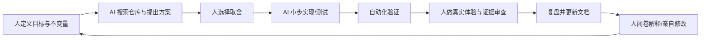

> 本轮整合上下文（2026-10-25）：本文原有叙述与验收数字保留为各节标明日期的历史快照。游戏主线已在候选提交 `96371eb36a787585cf5e70141c03555419821058` 保存，其父链包含九个 TowerRun/Portal/UI 提交；默认新冒险 Profile 为 `MainV1`，十二种保留原生怪物，Boss 仍待内容。旧 `ecology-v1`、UI v6 未提交、旧工作树/HEAD 等现在式叙述均不代表本轮状态。新整合 Build/Player 与人工验收只认本轮独立收据；Stage1、B1、Boss 和旧 R4 人工结论不升级。当前整合总账见 `../Integration/MainConsolidation20261025/README.md`。

# RPG_Demo AI 辅助开发实践

## 1. 事实边界

`【已验证事实】` 用户任务说明明确：项目大量代码由 Codex 辅助生成。Git 历史能证明系统演进和修改，但不能可靠逐行证明个人/AI 作者归属。

因此本项目最可信的表述不是：

> 我独立手写了全部代码。

而是：

> 我使用 Codex 辅助完成实现，并对需求边界、方案取舍、真实场景验收、问题复现、测试要求和知识复盘负责；对尚不能独立解释或修改的部分不声称掌握。

## 2. AI 最适合承担的工作

- 仓库搜索和调用链梳理；
- 生成机械性代码；
- 按现有模式扩展相似 Placement Service；
- 编写初版测试；
- 对比历史和当前实现；
- 提供备选设计；
- 生成文档初稿；
- 执行重复验证；
- 帮助构造故障矩阵。

## 3. 人必须负责的工作

- 产品语义：保存什么、死亡后回哪里；
- 不变量：旧世界是否保留、何时 Ready；
- 风险接受：复杂度、兼容性、性能；
- 真实体验：视觉、手感、音频；
- 外部行为：是否提交、推送、覆盖文件；
- 证据判断：测试是否真的证明结论；
- 最终责任：错误发生后如何处理。

## 4. 高质量 AI 任务描述

应包含：

```text
目标
当前真实状态
允许修改范围
禁止修改范围
业务不变量
验收条件
失败处理
需要保留的用户工作
```

本项目中的好约束示例：

- Commit 前生成失败保留旧 Active Map/Registry；TowerRun 上层仍可进入 Failure 并保持 Gate；
- `/learn/` 与 `.codex/` 不进入提交；
- 不修改已有未提交设置 UI；
- 当前 Slot 是入口检查点，不是 live save；
- 只有 GameplayReady 后才公开恢复完成；
- 不用 `-nographics` 证明 GPU 像素。

## 5. AI 生成代码审查框架

### 5.1 状态所有权

- 谁是权威源？
- 是否有两个模块同时修改同一事实？
- UI 是否反向成为状态源？

### 5.2 生命周期

- Awake/OnEnable/Start/OnDisable/OnDestroy 是否成对？
- 池化后是否重置？
- 场景切换和 Generation 切换是否安全？

### 5.3 失败路径

- 操作一半失败怎么办？
- 是否先执行不可逆动作？
- 回滚是否覆盖全部状态源？
- 错误是否被吞掉？

### 5.4 身份

- 是否使用稳定 ID？
- 重复/缺失 ID 怎么办？
- 是否错误使用对象名或数组索引？

### 5.5 测试

- 测的是机制还是实现细节？
- 环境是否匹配？
- 是否包含失败前红、修复后绿？
- 自动化未覆盖什么？

## 6. 常见 AI 失败模式

### 看起来完整，但语义错

例如把 `GameSaveService.TrySave()` 理解成磁盘保存，代码可编译，产品语义却错误。

### 过度自动修复

配置冲突时偷偷 fallback，使错误隐藏。项目选择 Authority fail-fast。

### 忽略已有脏工作树

AI 可能用 reset/restore 清理用户工作。正确做法是先 status，保护既有变更。

### 只跑方便的测试

用 `-nographics` 跑 Shader、同进程跑持久化，绿色结果没有证明目标。

### 一次写太多

大 diff 难审查、难定位回归。应分阶段提交/验证。

### 误把计划当实现

路线图中职业、复杂装饰、任务等不能自动进入项目介绍。

## 7. 人机协作闭环



最后一步很重要：没有闭卷解释和亲自修改，项目完成不等于学习完成。

## 8. 如何证明不是“只会提示词”

面试中用以下证据：

1. 能从入口走完整数据链。
2. 能说出失败路径和不变量。
3. 能区分历史、当前与建议。
4. 能现场定位一个类/测试。
5. 能预测修改影响。
6. 能先写回归再改代码。
7. 能指出 AI 方案哪里不准确。

## 9. 推荐面试表述

### 短版

> 我把 AI 当成实现与研究助手，不把它当成责任替代者。项目大量代码由 Codex 辅助，我负责约束需求、选择方案、保护仓库状态、验证真实流程并补足理解。我的掌握标准是能解释、能测试、能修改，而不是代码出现在我的仓库里。

### 追问版

> 例如迷雾 Bug 不是让 AI 随机改代码，而是先用测试和探针确认事件发生时玩家仍在旧位置，明确是完成边界问题，再调整时序并跑定向与流程回归。反过来，当前设置 UI 虽有 5/5 定向测试和截图，但用户视觉批准尚未完成，所以我不会说它已经正式完成。

## 10. 伦理和可信度

- 不伪造手写比例。
- 不隐瞒测试挂起。
- 不把自动化等同人工验收。
- 不提供虚构性能数据。
- 不用 AI 生成的解释替代自己的理解。
- 面试如被问及工具，应直接说明使用方式和限制。

可信度不是“少提 AI”，而是准确展示人在决策、验证和承担责任中的作用。

## 11. 个人掌握验证任务

以下任一完成，才形成新的掌握证据：

- 不看文档画出 Map 生命周期并由源码核对；
- 独立为一个 Placement policy 加约束和测试；
- 独立定位并修复一个对象池重复订阅问题；
- 为 SlotStore 加一个故障注入用例；
- 把商店事务迁移到一个新商品类型；
- 向别人讲解 15 分钟并回答追问。

## 12. AI 面试问答

### 12.1 你的项目有多少代码由 AI 辅助实现？

> 没有可靠的逐行统计，而且 Git 不能重建每一行的人机作者，所以我不会给虚构百分比。可以确定的是大量实现由 Codex 辅助。我的陈述重点是哪些需求、约束、验收和复盘由我负责，以及哪些系统我已经能独立解释和修改。

### 12.2 你具体负责什么？

> 我负责提出和收敛功能目标、约束修改范围、选择产品语义，例如 TowerRun 保存楼层入口而不是 live state；我检查工作树和历史，参与方案取舍、真实场景验收、问题复现、测试要求与知识整理。具体编码大量由 AI 完成，个人掌握度另外通过练习验证。

### 12.3 如果没有 AI，你能维护吗？

> 不能笼统回答全部可以。对地图生命周期、TowerRun 存档、背包交易等核心链路，我按入口、状态所有者、失败路径和测试逐步建立维护能力；对尚未闭卷复现的细节，我会先读测试和调用链、小步修改。我的目标是把依赖 AI 从“替我理解”降为“提高检索和实现效率”。

### 12.4 如何保证 AI 代码正确？

> 先写不变量和禁止范围，再让修改保持小步；用当前源码而不是路线图作依据；按机制选择 EditMode、PlayMode、GPU、跨进程和人工验收；审查失败路径、回滚、ID、生命周期和已有脏工作树。测试通过后仍记录环境和未测范围。

### 12.5 AI 代码出现问题怎么办？

> 先建立最小复现和失败证据，不让 AI 盲改。例如迷雾问题通过位置探针证明回调时玩家仍在旧坐标，再把问题收敛为完成边界。修复后同时跑定向回归和相关流程测试。

### 12.6 为什么采用 AI 辅助开发？

> 主要为了加快仓库检索、重复实现、测试初稿和方案比较，让我能在较短时间接触更完整的工程问题。代价是容易产生理解债务和过度复杂设计，所以必须配合 Git、测试、人工验收和学习计划。

### 12.7 如何判断 AI 提议的方案合理？

> 我会检查它是否解决真实故障、是否守住状态所有权和不变量、是否与项目规模匹配、有没有更简单替代、失败能否恢复、能否测试。比如 GenerationId 有旧代迟到的真实风险支持；把整个项目迁到 ECS 则没有当前数据支持。

### 12.8 你对核心系统掌握到什么程度？

> 我不会在没有现场考核时自报统一等级。我能给出当前证据：已经完成源码链路和历史复盘，并有对应练习计划；真正的 L3/L4 需要通过闭卷讲解、独立小改动和排错记录确认。面试时我愿意直接沿代码解释并完成小改动来证明。

